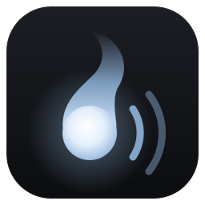
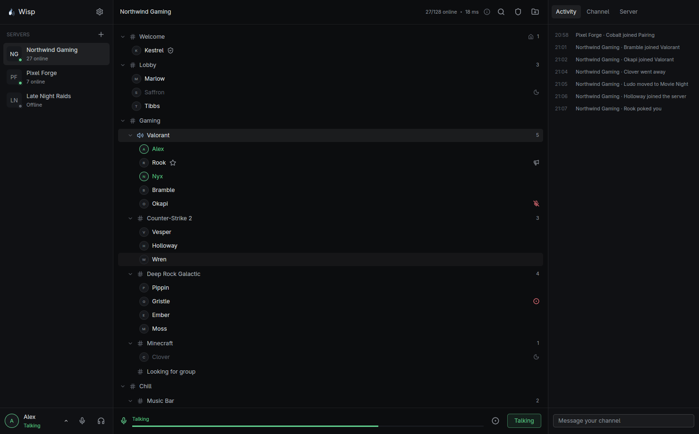

<p align="center">
  
</p>

<h1 align="center">Wisp</h1>

<p align="center">
  A voice chat client for TeamSpeak 3 servers, written in Rust.
</p>

<p align="center">
  <a href="#license"></a>
  
  <a href="https://github.com/TimKunze96/wisp/actions/workflows/build.yml"></a>
  
  
  
  
  
</p>

<p align="center">
  
</p>

## Why

The official TeamSpeak 3 client and I never got along on Linux. Global hotkeys
basically don't work under Wayland, and on Hyprland push-to-talk only fires
while the TeamSpeak window has focus, which defeats the point.

So I wrote my own client. It talks the TeamSpeak 3 protocol (through
[tsclientlib](https://github.com/ReSpeak/tsclientlib)), so it works with any
normal TS3 server, and push-to-talk goes through Hyprland key bindings, so it
works no matter which window is focused. Along the way it picked up a darker,
calmer look than the original and a few features I wanted for myself.

## Heads up: vibe coded

Most of this was written together with an AI coding assistant, with me steering,
testing and fixing. It runs my daily voice chat and works well for me, but it
hasn't had much review or testing beyond my own setup. Take it with a grain of
salt, expect rough edges, and please open an issue when something breaks.

## What it does

The usual TeamSpeak things:

- Several servers at once, channel tree with drag and drop, chat tabs with
  history, private messages, pokes, offline messages
- Push-to-talk or voice activation, whisper lists, per-user volume
- Channel editor, permissions, server and channel groups, bans, privilege keys,
  complaints, server settings and log, channel files, icons
- Identities, including importing and exporting TeamSpeak 3 ones, avatars

And some extras I found useful:

- Global push-to-talk with a release delay that works on Wayland (Hyprland)
- Noise suppression (RNNoise), echo cancellation and automatic gain
- Evening out loud and quiet voices, so nobody blows out your ears
- Turning other apps down while someone talks
- Recording to Ogg Opus
- Ctrl+K to jump to any server, channel or person
- Friends and blocked people, notifications, sounds and spoken events
- Tray icon, `ts3server://` links, autostart, and a command line for scripts
  and key bindings (`wisp status`, `wisp join`, `wisp ptt down`, see `wisp help`)

## Status

Linux is what I use every day: PipeWire for audio, Hyprland key bindings for
hotkeys (on other desktops you can bind `wisp ptt down` / `wisp ptt up`
yourself).

Windows and macOS builds are new and barely tested. Hotkeys are registered with
the system there, and echo cancellation and lowering other apps are Linux-only
for now. See [docs/PLAN.md](docs/PLAN.md) for what's left.

Wisp is an independent project. It is not made by, affiliated with or endorsed
by TeamSpeak Systems GmbH. "TeamSpeak" is their trademark and is only used here
to say which servers Wisp talks to. Like every third-party TeamSpeak client, Wisp
connects with the version information of an official client (through
tsclientlib), because servers expect it.

## Install

Grab the latest build from [Releases](https://github.com/TimKunze96/wisp/releases):

- Windows: `Wisp_..._x64-setup.exe` installs for your user, no admin needed.
  The build isn't signed, so SmartScreen warns once ("More info", "Run anyway").
- macOS: the `.dmg` for your Mac (`aarch64` for Apple Silicon, `x64` for
  Intel); drag Wisp to Applications. It isn't notarized, so the first start
  needs right-click, Open (or `xattr -dr com.apple.quarantine /Applications/Wisp.app`).
- Linux: the `.AppImage` (make it executable and run it) or the `.deb`. Wisp
  adds itself to your launcher and can take over `ts3server://` links (Settings).

Wisp checks for new releases and updates itself in place (Windows, macOS and
the AppImage; the `.deb` only points you to the download). Updates are signed,
and Wisp refuses anything that doesn't match the key built into it.

## Building

Needs Rust 1.88 or newer, CMake and a C compiler (for Opus).

```sh
cargo build --release
./target/release/wisp
```

`wisp --demo` starts with made-up servers and people (nothing connects, settings
go to a temporary folder); that's what the screenshot shows.

## License

[MIT](LICENSE). Third-party licenses are listed in
[THIRD-PARTY.md](THIRD-PARTY.md).

Recording a conversation can need everyone's consent where you live; Wisp shows
others that you are recording, the rest is up to you.
